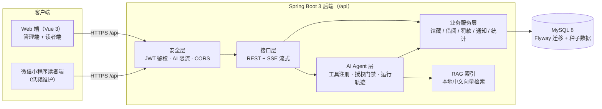

<div align="center">


# 智慧图书借阅管理系统

**一个面向毕业设计/学科竞赛的全栈实践项目：以 Web 端与服务端为主，附微信小程序读者端，内置 AI 助手。**

以 Spring Boot 3 服务端 + Vue 3 Web 端为主体（另含一个维护节奏较慢的微信小程序读者端），内置 AI 助手（LangChain4j + RAG 知识库）。

              

[功能特性](#功能特性) · [技术架构](#技术架构) · [快速开始](#快速开始) · [环境配置](#环境配置) · [项目结构](#项目结构) · [团队信息](#团队信息) · [参与贡献](#参与贡献)

**> 重要提示：本项目为毕业设计作品，仅供学习交流，未经过生产环境验证。功能以演示完整度为目标，安全加固、容错与性能均未按商业标准打磨，请勿直接用于真实图书馆业务。使用前请备份数据；如遇到问题，欢迎到 [Issues](../../issues) 提交反馈。首次启动后端时 Flyway 会自动建库表并写入种子数据，无需手动执行 SQL。**

</div>

---

## 功能特性

> 当前开发重心为 **Web 端与服务端**：下面列出的是已实现并可演示的能力。微信小程序读者端为早期版本，仍在维护但迭代较慢，本文档仅在快速开始中保留最小启动步骤。

### 馆藏与检索

- **分类管理**：多级分类树，新增 / 编辑 / 启停 / 删除，可按分类过滤馆藏。
- **图书管理**：书名 / 作者 / ISBN 检索，新增与编辑，馆藏位置、总册数与可借册数台账，图书详情页。
- **封面多通道**：支持外链封面与本地上传，列表 / 详情 / 排行统一渲染，无封面时回落为首字占位。
- **AI 智能检索联动**：在馆藏页用自然语言发起检索，结果回填为图书列表（顶部 AI 结果条），可一键返回普通检索。

### 借阅与流通

- **全流程状态机**：申请 → 取书码（扫码取书）→ 借阅中 → 续借 → 归还申请 → 柜台确认 / 驳回，状态流转与逾期口径统一由服务端裁决。
- **柜台效率工具**：扫码办理、批量办理、批量催还、归还确认与驳回。
- **额度与规则**：按角色配置可借册数、借阅天数与续借规则；逾期未还拦截口径由服务端统一裁决，每日滞纳金费率可在管理端调整。
- **罚款**：逾期自动结算，罚款列表与缴纳确认（记录制，不接入第三方支付），管理端可看全馆未缴罚款汇总。

### 通知与公告

- **催还通知**：站内信 + 邮件（SMTP）双通道，支持到期前提醒与逾期 D1 / D3 / D7 分级规则，渠道与文案可配置。
- **通知运营**：发送状态跟踪（待发送 / 已发送 / 失败 / 跳过）、失败重发、手动触发，便于演示与排错。
- **公告**：发布、置顶、删除，概览页展示最新馆讯。
- **站内通知**：顶栏未读数、通知抽屉、单条 / 全部已读。

### AI 助手

- **流式对话**：SSE 逐段返回，支持深度思考（思维链）展开、停止生成与会话管理（新建 / 删除 / 自动标题）。
- **分角色工具调用**：管理员工具（馆藏 / 借阅 / 读者 / 统计）与读者工具（我的借阅 / 续借 / 罚款）隔离，避免越权查询。
- **写操作授权门禁**：授权卡逐笔确认、批量授权、自动执行（仅管理员）；决策结果落库，刷新或切换会话后仍可回看，并支持会话级白名单。
- **生成式 UI 卡片**：查询结果以内联卡片渲染（书籍、借阅单、图表等），随消息持久化，跨会话常驻。
- **全站 AI 悬浮球**：除 AI 助手页外的任意页面可唤起 AI 会话；在馆藏页触发的检索会回填图书列表，避免误触发筛选。
- **RAG 知识库**：文档上传 / 文本录入、启用停用、片段查看、单文档重建与全量重建、检索命中测试、RAG 参数配置；馆规文档由管理员在「知识库」页维护（本地 `rag-docs/` 为维护者自用资料，不入库）。
- **Agent 运行日志**：可视化查看工具调用序列、授权门禁触发、耗时与结果。
- **接口治理**：AI 对话 / 确认接口独立限流，模型请求与响应日志可开关。

### 平台与工程

- **权限与安全**：JWT 鉴权、登录态过期自动清理并跳转、CORS 白名单、统一返回体。
- **系统设置**：账户安全、AI 服务渠道（多渠道路由 / 优先级 / 连通性测试 / 拉取模型）、借阅额度、逾期罚款、AI 人设、催还规则、邮件渠道。
- **读者管理**：教师 / 学生 / 管理员三类角色，新增 / 编辑 / 状态维护、读者详情。
- **数据可视化**：管理员与读者双视角仪表盘（概览指标、借阅趋势、在办状态、馆藏分类、借阅热门、馆讯）。
- **数据库版本化**：Flyway 迁移是库结构唯一事实来源（V1–V13，含种子数据，首次启动自动建库）。
- **工程化**：约定式提交钩子、CI 校验、tag 触发构建与自动 Release、深色主题与响应式布局。

## 技术架构

### 整体架构



### 后端分层

| 层 | 目录 | 职责 |
|---|---|---|
| 接口层 | `controller/` | REST 接口与 SSE 流式对话（`POST /api/ai/chat`） |
| 业务层 | `service/` | 借阅状态机、罚款结算、通知投递、统计口径、AI 编排 |
| 数据层 | `mapper/` + `resources/mapper/*.xml` | MyBatis SQL 映射，统一走 XML 便于审查 |
| 领域对象 | `entity/` `dto/` | 表实体、请求/响应模型 |
| 基础设施 | `config/` `security/` `common/` | JWT 过滤器、AI 限流拦截器、CORS、统一返回体 |
| 数据迁移 | `resources/db/migration/` | Flyway 为库结构唯一事实来源（V1–V13，含种子数据） |

### AI Agent 与 RAG 链路

1. **流式对话**：`POST /api/ai/chat` 返回 `text/event-stream`，前端逐段渲染；
2. **工具调用**：`AiToolRegistry` 注册工具，按角色拆分为 `AdminTools`（馆藏/借阅/读者管理）与 `ReaderTools`（个人借阅、续借、罚款），共用 `BaseLibraryTools`/`CommonTools`；
3. **写操作门禁**：写类工具不直接执行，先生成授权卡（单条/批量），用户确认后由服务端按令牌执行，并由前端以续跑标记发起下一轮；`PermissionMode` 提供逐笔确认 / 批量授权 / 自动执行（仅管理员）三档，`AiSessionAllowService` 支持会话级白名单；
4. **运行轨迹**：每次工具调用与授权决策写入 `ai_agent_traces`，管理端「Agent 日志」页可查看；
5. **RAG 知识库**：管理员在「知识库」页上传或录入馆规文档，分块后由本地 `bge-small-zh-v1.5` 中文向量模型（ONNX，零 API 成本）计算向量并落库 `rag_segments`，检索在进程内完成；
6. **模型渠道**：管理端「系统设置 → AI 渠道」按优先级维护 OpenAI 兼容渠道（DeepSeek / 通义千问 / Kimi 等），配置 provider / apiKey / model / endpoint，Key 存库且接口返回脱敏。

### 各端职责

| 端 | 用户 | 主要能力 |
|---|---|---|
| Web 管理端（主力） | 管理员 | 馆藏 / 分类 / 读者 / 借阅 / 罚款 / 公告管理，AI 服务渠道与知识库、Agent 日志、系统设置、仪表盘 |
| Web 读者端（主力） | 教师 / 学生 | 馆藏检索、借阅申请与续借、罚款查询、公告、AI 助手 |
| 小程序读者端（低频） | 教师 / 学生 | 书库浏览、借阅记录、罚款、消息、AI 助手（覆盖阅读核心场景，迭代较慢） |

> 小程序端目前仅做必要维护，新增功能优先在 Web 端与服务端落地。生产部署只需 Web 端 + 服务端即可完整演示。

### 技术栈

| 端 | 技术 |
|---|---|
| 后端 | Java 22 · Spring Boot 3.3 · MyBatis · MySQL 8 · Flyway · LangChain4j 1.22 · JJWT · JavaMail |
| Web 前端 | Vue 3 · Vite 8 · Element Plus · Pinia · ECharts 6 · markdown-it |
| 小程序 | 微信原生小程序（自定义 tabBar、分包加载，维护节奏较慢） |

## 快速开始

### 环境要求

- JDK 22（若本机只有 JDK 21，可加 `-Dmaven.compiler.release=21` 编译）、Maven 3.9+
- Node.js 20.19+ 或 22.12+（Vite 8 的 engines 要求）、pnpm
- MySQL 8.0
- 微信开发者工具（仅小程序端）

### 1. 后端

```bash
cd backend
# 复制环境变量模板并填入数据库密码、JWT secret（.env 已被 .gitignore 忽略，不会提交）
cp .env.example .env
mvn spring-boot:run
```

> 首次启动前必填 `DB_PASSWORD` 与 `JWT_SECRET`（缺失时后端拒绝启动，模板内有生成指引）；微信小程序配置可留空。后端自动读取 `backend/.env`，也可改用环境变量注入。
>
> 数据库无需手动创建：JDBC 连接带了 `createDatabaseIfNotExist=true`，Flyway 会在首次启动时自动建表并写入种子数据。

### 2. Web 前端

```bash
cd frontend
pnpm install
pnpm dev
# 默认 http://localhost:5173，/api 由 Vite 代理到 http://127.0.0.1:8090
```

### 3. 微信小程序（可选，低频维护）

> 小程序端不是演示必需项，Web 端 + 服务端即可完整跑通业务流程；小程序端目前仅做必要维护。

用微信开发者工具导入 `miniprogram-reader/` 目录：

1. 在 `project.config.json` 中配置自己的 appid；
2. 修改 `miniprogram-reader/utils/core/config.js` 的 `DEV_ORIGIN` 为后端所在机器的局域网地址（如 `http://192.168.1.200:8090`）；
3. 开发者工具勾选「不校验合法域名」即可用 http 调试本机后端；正式版需 HTTPS 域名并在小程序后台登记。

## 环境配置

### 环境变量清单

模板文件：[.env.example](./.env.example)（仓库根）与 [backend/.env.example](./backend/.env.example)，变量项一致（注释措辞略有差异），复制任意一份为 `.env` 放在 `backend/` 或仓库根均可（后端两处都会读取）。模板只收录必填与常用项，下表里的 `SERVER_PORT`、`VITE_BACKEND_TARGET` 按需自行补入。

| 变量 | 必填 | 默认值 | 说明 |
|---|---|---|---|
| `SERVER_PORT` | 否 | `8090` | 后端端口，统一前缀 `/api` |
| `DB_HOST` | 否 | `localhost` | MySQL 主机 |
| `DB_PORT` | 否 | `3306` | MySQL 端口 |
| `DB_USERNAME` | 否 | `root` | MySQL 用户名 |
| `DB_PASSWORD` | **是** | — | MySQL 密码，缺失后端拒绝启动 |
| `JWT_SECRET` | **是** | — | HS256 密钥，需 ≥32 字节随机串（`openssl rand -base64 48`） |
| `JWT_EXPIRE_MS` | 否 | `86400000` | Token 有效期（毫秒），默认 24 小时 |
| `WECHAT_APPID` | 否 | 空 | 小程序 AppID；留空不影响 Web 端启动，仅小程序登录不可用 |
| `WECHAT_SECRET` | 否 | 空 | 小程序 AppSecret，同上 |
| `VITE_BACKEND_TARGET` | 否 | `http://127.0.0.1:8090` | 前端开发代理目标，写在 `frontend/.env.local` |

> AI 模型的 provider / apiKey / model / endpoint **不通过环境变量配置**，在管理端「系统设置 → AI 渠道」写入数据库（Key 脱敏返回）。
> 本地开发 profile `dev` 会开启 Mapper SQL 日志；生产请改用 `--spring.profiles.active=prod` 或移除 `dev`。

### 依赖清单

| 端 | 依赖清单文件 | 关键依赖 |
|---|---|---|
| 后端 | [backend/pom.xml](./backend/pom.xml) | Spring Boot 3.3.5、mybatis-spring-boot-starter 3.0.4、pagehelper 2.1.0、flyway-core/mysql、mysql-connector-j、jjwt 0.12.6、langchain4j 1.22.0、langchain4j-embeddings-bge-small-zh-v15-q、spring-boot-starter-mail |
| Web 前端 | [frontend/package.json](./frontend/package.json) + `pnpm-lock.yaml` | vue 3.5、vite 8、element-plus 2.14、pinia 4、echarts 6、gsap 3、axios、markdown-it、highlight.js、qrcode |
| 小程序 | [miniprogram-reader/package.json](./miniprogram-reader/package.json) | 微信原生运行时；唯一第三方依赖 `marked`（Markdown 渲染，可选，缺失时降级纯文本），`miniprogram_npm/` 由开发者工具「构建 npm」生成，不入库 |

### 端口与网络

| 服务 | 端口 | 说明 |
|---|---|---|
| 后端 | `8090`（`/api` 前缀） | 避开常被占用的 8080/8081，可用 `SERVER_PORT` 覆盖 |
| 前端开发服务器 | `5173` | `/api` 反向代理到后端，支持局域网访问 |
| MySQL | `3306` | 库名 `library_db`，首次启动自动创建 |

### AI 服务渠道配置（可选）

AI 助手需要至少一条可用渠道，否则对话会返回未配置提示：

1. 管理员登录 → 系统设置 → AI 渠道 → 新增渠道；
2. 填写 provider（OpenAI 兼容服务）、endpoint、model 与 apiKey；
3. 保存后可「测试」连通性并拉取模型列表；渠道按列表顺序生效，停用自动跳过。

## 项目结构

```text
smart-library/
├── backend/            # Spring Boot 后端
│   └── src/main/
│       ├── java/com/library/
│       │   ├── controller/    # REST + SSE 接口
│       │   ├── service/       # 业务服务（借阅、AI、RAG、统计…）
│       │   ├── mapper/        # MyBatis Mapper
│       │   ├── entity/ dto/   # 领域对象
│       │   ├── security/ config/ common/
│       └── resources/
│           ├── db/migration/  # Flyway 迁移脚本（自动建库 + 种子数据）
│           ├── mapper/        # MyBatis XML
│           └── prompts/       # AI 人设提示词
├── frontend/           # Vue 3 管理端 + 读者端 Web
│   └── src/
│       ├── views/      # 页面（仪表盘、图书、借阅、AI 助手、系统设置等）
│       ├── components/ # 通用组件与 AI 组件
│       ├── stores/ api/ router/ layout/ styles/
├── miniprogram-reader/ # 微信小程序读者端（低频维护，可选部署）
├── .githooks/          # 提交规范钩子（自动 scope 推断 + 校验）
├── .github/            # CI/CD 工作流与 git-cliff 配置
└── docs/images/        # 图片资源（logo 等；设计文档不入库）
```

## 团队信息

| 项目 | 内容 |
|---|---|
| 参赛赛事 | 第九届传智杯全国大学生数智创新与 AI 应用大赛 |
| 团队名称 | 天天向上 |
| 学校 / 学院 | 重庆城市科技学院 |
| 指导教师 | 左亚玲 |
| 团队成员 | 肖街伟、刘丹亚、刘欣悦 |

## 参与贡献

```bash
sh .githooks/install.sh    # 启用提交规范钩子（首次克隆后执行一次）
```

提交信息遵循约定式提交（`feat` / `fix` / `perf` / `refactor` / `docs` / `test` / `build` / `ci` / `chore` / `revert`），scope 固定枚举并由钩子自动推断，CHANGELOG 由 [git-cliff](https://github.com/orhun/git-cliff) 在发版时自动生成。详见 [CONTRIBUTING.md](./CONTRIBUTING.md)。

## 更新日志

见 [Releases](../../releases)（tag 触发 CI 自动构建发布产物并生成变更日志）。

## License

[MIT](./LICENSE)
